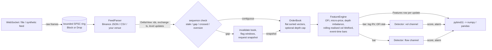

# MicroPulse

A C++17 limit-order-book reconstruction and real-time feature engine, with pybind11 bindings so a
statistical regime-detection layer (pandas / scikit-learn / scipy) can consume the same features
that the hot path computes — without reimplementing the hot path in Python.

* **Core (header-only C++)** — price-level order book, incremental features (order-flow imbalance,
  micro-price, depth imbalance, realised volatility with Welford's algorithm), sequence-gap
  handling with snapshot resync, bounded SPSC ingestion queue, pluggable venue parsers, pluggable
  online change detectors (CUSUM, Bayesian online changepoint detection).
* **Benchmarks** — latency (p50/p99/p99.9), throughput, memory, incremental-vs-naive speedup,
  burst load with backpressure vs drop, quote-stuffing before/after hardening.
* **Research layer (Python)** — calibration of detector thresholds against labeled regime changes
  with false-positive rates and confidence intervals; spoofing and quote-stuffing robustness tests.
* **Reports** — [`reports/BENCHMARK.md`](reports/BENCHMARK.md), [`reports/CALIBRATION.md`](reports/CALIBRATION.md).

> **Read this first — what is and is not validated.** The build environment had no outbound
> network access, so **no real Binance data was captured or replayed**. The Binance parser is
> tested against payloads in the documented wire format, and a recorder script
> (`python/micropulse_research/record_binance.py`) plus a replay path (`Engine.replay_file`) are
> included, but all calibration and benchmark numbers come from the **synthetic L2 generator**
> (`include/micropulse/synth.hpp`). They validate correctness, performance and detector mechanics;
> they do **not** establish how the detectors behave on a live market. Thresholds must be re-calibrated
> on a real capture before use. Benchmarks ran on a **1-vCPU virtual machine**, which affects what can
> be measured (see the benchmark report).

## Architecture



```
 exchange timestamp ──► event time: windows, bars, features      (never mixed with local clocks)
 rdtscp / steady clock ► latency measurement only
```

| Component | File | Notes |
|---|---|---|
| Types, flags | `include/micropulse/types.hpp` | int64 fixed-point (1e-8) prices/qty; quality-flag bits |
| Order book | `book.hpp` | best level at the back of a sorted vector; galloping search from the touch; optional depth cap with O(1) rejection of far-from-touch updates |
| Rolling stats | `window.hpp` | Welford add **and remove**, exact int64 OFI sums, periodic exact refresh; `NaiveWindow` = recompute baseline / test oracle |
| Features | `features.hpp` | OFI (Cont–Kukanov–Stoikov), micro-price, depth imbalance, grid-sampled realised volatility, event-time bars |
| Detectors | `detector.hpp` | `Detector` interface; `CusumDetector`, `BocpdDetector` |
| Parsers | `parser.hpp` | `FeedParser` interface; `BinanceDepthParser`, `CsvDeltaParser` |
| Engine | `engine.hpp` | orchestration + failure handling (below) |
| Ingestion | `pipeline.hpp` | bounded lock-free SPSC ring, Block / Drop policies, consumer thread |
| Synthetic feed | `synth.hpp` | regimes, spoofing, quote stuffing, impairments, exact snapshots for resync |
| Bindings | `bindings/pybind_module.cpp` | `Engine`, `simulate`, detector replay, numpy outputs |

## Build, test, benchmark, calibrate

```sh
make build/test_main build/bench_main python      # or: cmake -B build -DMICROPULSE_PYTHON=ON -Dpybind11_DIR=$(python3 -m pybind11 --cmakedir) && cmake --build build
./build/test_main                                 # 15 tests: Welford, book invariants, OFI, parsers, gaps, SPSC, detectors, incremental==naive
./build/bench_main all > reports/benchmark_results.md      # add --quick for a short run
cd python && python3 -m micropulse_research.calibrate 8   # ~10 min, writes reports/calibration_results.json
scripts/run_all.sh                                # everything above
```

Requirements: g++ ≥ 9 or clang ≥ 10 (C++17), Python ≥ 3.9 with numpy, scipy, pybind11 (calibration only needs the
built module). The core has no third-party dependencies.

```python
import micropulse_research as mp
e = mp.Engine(max_levels=256, window_s=1.0, bar_ms=250, record_features=True)
e.add_cusum("vol"); e.add_bocpd("vol"); e.add_cusum("flow")     # swap detectors without touching ingestion
mp.simulate({"seed": 1, "duration_s": 600, "regimes": [(0, 1.0, 1.0), (300, 4.0, 2.5)]}, e)
import pandas as pd
df  = pd.DataFrame(e.features_table())      # per-update features
bars = pd.DataFrame(e.bars())               # per-bar detector inputs, scores, alarms
e.alarms()                                  # alarm log
# live / recorded Binance data:  e.replay_file("data/btcusdt.cap")  or  e.on_frame(raw_json_bytes)
```

## Design decisions that matter

**Book.** Each side is a contiguous vector sorted so the best level is at the back. Updates cost
`O(log k)` search (galloping from the touch) plus an `O(k)` memmove, where `k` is the number of
levels *better* than the updated one — tiny for realistic flow, but `O(n)` for an adversary who
churns the deepest levels. That is why the book can be **capped** (`max_levels`, default 256): the
retained set is always exactly the true top-*n* levels (property-tested), updates beyond the horizon
are rejected in `O(1)`, and the engine requests a snapshot *refill* if deletions shrink the retained
depth below what the features need. Full depth (`max_levels=0`) remains available.

**Incremental features.** Rolling windows are in *exchange event time*. Return statistics use
Welford add/remove; OFI uses exact integer sums, so there is no drift in the flow statistic. The
textbook `E[x²]−E[x]²` formula is shown to fail on offset data (`test_welford_stability`:
relative error ≈1e12 vs ≈1e-5 for Welford). Sliding-window removal accumulates rounding error, so an
exact recompute from the ring runs every 65 536 evictions (`test_sliding_welford_drift` measures
both). Realised volatility uses mid returns **sampled on a 50 ms event-time grid**, not per-touch-change
returns: on a one-tick-wide book tick-time returns are dominated by bid/ask bounce (verified on the
synthetic feed: the regime signal was nearly invisible until the grid was introduced).

**Clock skew.** Exchange timestamps define event time for every window, bar and feature. A
monotonic clock (`rdtscp`, calibrated against `steady_clock`) is used *only* for latency. The two
are never subtracted from each other. If the exchange clock goes backwards the timestamp is clamped
(windows stay monotone) and `F_TS_REGRESSION` is raised. The unknowable part — exchange→host
network delay plus clock offset — is **not measured** by this system; measuring it needs an external
reference (PTP/NTP discipline or exchange-side echo timestamps).

**Failure handling** (`engine.hpp`; every case is unit-tested, see `tests/test_main.cpp`):

| Condition | Behaviour |
|---|---|
| duplicate / stale message (`last_id ≤ applied`) | dropped, counted |
| id discontinuity or out-of-order arrival | book invalidated, deltas dropped until a snapshot, **rolling windows flagged `F_WINDOW_TAINTED` for exactly one window length**, the return across the gap is never formed, detector bars overlapping the gap are flagged and **not fed to detectors** |
| crossed book after a message | treated as a gap |
| oversize message (hardening limit) | treated as a gap |
| truncated book shrinks below feature depth | refill snapshot requested; features stay exact meanwhile |
| parse error | counted; the missing ids surface as a gap on the next message |
| burst beyond capacity | bounded ring: **Block** (backpressure) or **Drop newest** (drops surface as a gap → resync, flagged, never silent) |

There is no reorder buffer: out-of-order delivery costs a resync rather than being silently repaired.
That is a deliberate simplicity/correctness trade-off.

**Pluggability.** `FeedParser` maps a wire format onto `DeltaView`/`SnapshotOwned`; swapping
`BinanceDepthParser` for `CsvDeltaParser` yields bit-identical book-derived features
(`test_pluggable_parser_equivalence`). `Detector::update(ts, x)` is called once per bar; swapping CUSUM
for BOCPD is a one-line change at `add_detector()`.

**Detectors.** Both consume one scalar per 250 ms event-time bar: `log(Σ r² + ε)` (volatility
channel) or the order-flow statistic (flow channel). CUSUM is a standardised two-sided Page test
with a slowly adapting baseline. BOCPD is Adams–MacKay with a Normal-Inverse-Gamma conjugate model
(Student-t predictive), constant hazard, truncated run-length posterior (bounded `O(r_max)` per bar),
log-space arithmetic, and an observation clip. Because under a constant hazard `P(r_t=0)` is
identically the hazard, the alarm statistic is the posterior mass on **short run lengths**
`P(r_t ≤ k)`. Hyper-parameters and thresholds are *calibrated*, not textbook — see the calibration
report for why that matters (textbook CUSUM settings give tens of false alarms per hour on this data).

**Manipulation robustness.** Spoofing: the flow channel uses a winsorised OFI (touch quantity capped
at 8× its EWMA) and a scale-free statistic `Σe/√Σe²` for which one huge order can move the bar value
by at most ±1; the volatility channel is unaffected by resting size that never trades. Quote stuffing:
the depth cap makes far-from-touch churn `O(1)`; the queue is bounded; the rolling ring is bounded and
raises `F_RING_OVERFLOW` instead of growing. The reports quantify each claim, including where it does
not hold.

## Known limitations

* No real-market validation (see the notice above). The generator is a simple model: Brownian fair
  value, Poisson churn, geometric/heavy-tailed depths. Real books have richer dynamics, time-of-day
  seasonality, and correlated cross-venue flow.
* Single symbol per engine; one detector instance per channel/bar; up to 4 detector slots.
* Latency numbers are from a shared 1-vCPU VM; absolute values will differ on dedicated, pinned
  hardware. `max` latencies are dominated by VM scheduling noise.
* Snapshot refill and resync are modelled as instantaneous in the core benchmarks and as a fixed 50 ms
  asynchronous delay in the burst simulation; real REST latency and rate limits are not modelled.
* The two-thread `Pipeline` is correctness-tested but its latency could not be meaningfully measured
  on one vCPU; the burst study therefore uses a virtual-time queue driven by *measured* service times.
* Feeds without sequence ids (no `U`/`u`) would need a checksum-based integrity check; not implemented.
